# Penetration Testing Report

FOOTPRINTING & NETWORK SCANNING PHASES

W2-PM1 \| W2-PM5 \| CYBERSECURITY \| NETWORKWALKS

<table>
<colgroup>
<col style="width: 29%" />
<col style="width: 70%" />
</colgroup>
<tbody>
<tr class="odd">
<td><strong>Pentester Name (Cybersecurity Professional)</strong></td>
<td><strong>Chelsea Ribeiro</strong></td>
</tr>
<tr class="even">
<td><strong>Program/Batch</strong></td>
<td>B084J (Networkwalks)</td>
</tr>
<tr class="odd">
<td><strong>Date</strong></td>
<td>13 November 2026</td>
</tr>
<tr class="even">
<td><strong>Modules completed</strong></td>
<td>
W2-PM1 (Footprinting with Multiple Kali Tools)

W2-PM5 (Zenmap Network Scanning)
</td>
</tr>
<tr class="odd">
<td><strong>Client/Target</strong></td>
<td>
1. Networkwalks: networkwalks.com (target assigned by the course)

2. My own local LAN network
</td>
</tr>
<tr class="even">
<td><strong>Permission secured from client?</strong></td>
<td>Yes. Permission for networkwalks.com was already secured by Networkwalks as part of the course; the local network is my own.</td>
</tr>
<tr class="odd">
<td><strong>Phases covered</strong></td>
<td>
<strong>Phase 1:</strong> Reconnaissance &amp; Footprinting

<strong>Phase 2:</strong> Scanning &amp; Network Discovery

<strong>Phase 3-5:</strong> In Progress
</td>
</tr>
</tbody>
</table>

# 1. Liability Disclaimer

I have performed these activities only on the systems and devices where I had permission or that I own myself. All these materials are for education and research purposes only. Do not use anything from here to break the law. The instructor, the authors and Networkwalks are not responsible for what you do with this knowledge. Every action you take is your own responsibility. Misuse can lead to criminal charges, heavy fines, loss of your job and a permanent record. In most countries unauthorised access is a crime even when nothing is damaged.

# 2. Introduction

This report covers two Week 2 modules of my Cybersecurity & Ethical Hacking course at Networkwalks. W2-PM1 footprinted the networkwalks.com domain using six built-in Kali Linux tools. W2-PM5 scanned my own local network with Zenmap to discover live hosts.

Together these modules show how an attacker moves from gathering public information about a domain to mapping live hosts on a network. Every step below includes the exact command or action used, the result observed, a screenshot as evidence, and a short note on why the finding matters from an attacker's point of view.

# 3. Tools Used

The table below lists each tool used in this report and its purpose.

| **Tool**               | **Purpose**                                                                               |
|------------------------|-------------------------------------------------------------------------------------------|
| Kali Linux & Windows   | Operating systems used for the reconnaissance and scanning activities.                    |
| whois                  | Find domain registration details (registrar, dates, name servers).                        |
| whatweb                | Fingerprint web technologies (server, CMS, plugins, IP).                                  |
| nslookup               | Resolve the domain name to its IP address using DNS.                                      |
| curl -I                | Read the HTTP response headers of the website.                                            |
| wafw00f                | Detect whether a Web Application Firewall (WAF) protects the site.                        |
| dnsrecon               | Enumerate DNS records (SOA, NS, MX, A, SRV).                                              |
| Zenmap (Nmap GUI)      | Scan the local subnet to find live hosts, IPs and MAC addresses, and draw a topology map. |
| Windows CMD (ipconfig) | Find my PC's local IP address, subnet mask and MAC address.                               |

# 4. Activities Performed

## 4.1 Footprinting & Reconnaissance with Kali Tools (W2-PM1)

Footprinting means collecting public information about a target before touching it. I ran six Kali Linux tools against networkwalks.com, each revealing a different piece of the picture.

| **Tool / Command**                       | **What I found**                                                                                                                                                                                                                                                             | **Why it matters to an attacker**                                                                                      |
|------------------------------------------|------------------------------------------------------------------------------------------------------------------------------------------------------------------------------------------------------------------------------------------------------------------------------|------------------------------------------------------------------------------------------------------------------------|
| Task 1: whois networkwalks.com           | Registrar: GoDaddy.com, LLC. Created 6 Nov 2019, expires 6 Nov 2027. Name servers: NS6135.HOSTGATOR.COM and NS6136.HOSTGATOR.COM. DNSSEC: unsigned.                                                                                                                          | Shows who hosts the site (HostGator). Dates and abuse contacts can help with social engineering.                       |
| Task 2: whatweb networkwalks.com         | The site redirects HTTP to HTTPS. Apache web server, WordPress 7.1.4, WP Download Manager 3.3.76, jQuery 3.7.1. IP address 192.232.216.135. Contact email info@networkwalks.com exposed.                                                                                     | Exact software versions can be looked up in vulnerability databases. It also leaks the server IP and an email address. |
| Task 3: nslookup networkwalks.com        | Non-authoritative answer from my local DNS server (172.20.10.1): networkwalks.com resolves to 192.232.216.135.                                                                                                                                                               | Knowing the real IP lets an attacker scan the server directly and map the infrastructure.                              |
| Task 4: curl -I https://networkwalks.com | HTTP/2 200 response. Header server: Apache, x-nginx-cache: WordPress, a session cookie (\_\_wpdm_client, marked Secure and HttpOnly), and a link header exposing the WordPress REST API at /wp-json/.                                                                        | Headers reveal the web server, caching setup and hidden endpoints without loading the page.                            |
| Task 5: wafw00f networkwalks.com         | The site is behind a **ModSecurity (SpiderLabs)** WAF. Number of requests: 2.                                                                                                                                                                                                | Tells an attacker that simple attacks will be blocked or logged, so they must adapt.                                   |
| Task 6: dnsrecon -d networkwalks.com     | SOA and NS records (ns6135.hostgator.com 50.87.144.87, ns6136.hostgator.com 192.232.216.131), MX mail.networkwalks.com (192.232.216.135), A record 192.232.216.135, and 8 cPanel \_autodiscover SRV records (cpanelemaildiscovery.net). The DNSSEC query returned no answer. | Maps the DNS footprint: name servers, mail server and the cPanel hosting setup.                                        |

**Key terms in plain language:**

- **WAF (Web Application Firewall):** a filter in front of a website that blocks suspicious web requests.

- **DNS:** the internet's phone book, which turns names like networkwalks.com into IP addresses.

- **NS / MX records:** NS says which servers answer DNS questions for the domain; MX says which servers receive its email.

- **SRV records:** DNS records that point to specific services (here, cPanel email auto-discovery).

- **Fingerprinting:** working out what software a system runs from the clues it gives away.

## 4.2 Network Scanning with Zenmap (W2-PM5)

Zenmap is the official graphical interface for Nmap, a free and open-source security scanner. I completed the seven tasks of the practical on my own network as follows.

| **Task** | **What was required**                   | **What I did / result**                                                                                                                                                       |
|----------|-----------------------------------------|-------------------------------------------------------------------------------------------------------------------------------------------------------------------------------|
| Task 1   | Download and install Zenmap             | Downloaded the Nmap installer from nmap.org/download.html and installed it with all default components (this includes Zenmap and Npcap). Version: Nmap 7.993.                 |
| Task 2   | Find my local IP address and LAN subnet | Ran ipconfig in Windows CMD. IPv4 address: 172.20.10.6. Subnet mask: 255.255.255.240. LAN subnet: 172.20.10.0/28 (default gateway 172.20.10.1).                               |
| Task 3   | Find live hosts in the subnet           | Entered 172.20.10.0/28 in the Zenmap Target box, selected the Ping scan profile (nmap -sn 172.20.10.0/28) and clicked Scan.                                                   |
| Task 4   | How many hosts are live?                | 3 hosts are live (including my own PC). Nmap scanned 16 IP addresses in 3.16 seconds.                                                                                         |
| Task 5   | IP addresses of the live hosts          | 172.20.10.1, 172.20.10.2 and 172.20.10.6.                                                                                                                                     |
| Task 6   | MAC addresses of the live hosts         | 172.20.10.1: EA:78:65:37:2C:64. 172.20.10.2: 22:74:C9:6B:0E:E5. 172.20.10.6 (my PC, from ipconfig /all): 5C-BA-EF-73-B3-AF.                                                   |
| Task 7   | Save the topology as PDF                | Opened the **Topology** tab, turned on the legend, and used **Save Graphic** to save the topology as a PDF on my desktop. File name: \[file name\]. |

**Live hosts discovered:**

| **\#** | **IP Address** | **MAC Address**   | **Notes (device type, vendor)**                                           |
|--------|----------------|-------------------|---------------------------------------------------------------------------|
| 1      | 172.20.10.1    | EA:78:65:37:2C:64 | Default gateway, DHCP and DNS server (router or hotspot). Vendor unknown. |
| 2      | 172.20.10.2    | 22:74:C9:6B:0E:E5 | Another device on the LAN. Vendor unknown.                                |
| 3      | 172.20.10.6    | 5C-BA-EF-73-B3-AF | My own PC (Realtek RTL8821CE Wi-Fi adapter).                              |

**Reading the topology:** each dot in the topology is a host, and the legend explains the colours (for example, green means a host with fewer than 3 open ports, which is expected for a ping scan that does not scan ports). In my topology, my machine (localhost) sits in the centre and the live hosts 172.20.10.1, 172.20.10.2 and 172.20.10.6 are drawn as green dots. The map also lists 192.168.56.1 and 192.168.100.100, which are not in the Nmap output of this scan; they most likely come from other scans or virtual adapters kept in the same Zenmap session, so they are not counted as live hosts of this subnet.

**Note:** a ping scan (-sn) only finds which hosts are up. It does not scan ports or services, so no vulnerabilities were tested.

# 5. Risk Analysis / Impact

Based on the information collected during the footprinting and network scanning activities, I identified the following potential risks.

| **\#** | **Risk / Finding**                           | **Evidence / Observation**                                               | **Potential Impact**                                                                                | **Risk Level** |
|--------|----------------------------------------------|--------------------------------------------------------------------------|-----------------------------------------------------------------------------------------------------|----------------|
| 1      | Web technology information exposed           | WhatWeb identified WordPress 7.1.4 and WP Download Manager 3.3.76        | Attackers may use exposed version information to look for known weaknesses that need further review | **Medium**     |
| 2      | Server IP address identifiable               | Nslookup resolved the domain to 192.232.216.135                          | Provides information about the network location of the web service                                  | **Low**        |
| 3      | HTTP technical information exposed           | Curl returned headers showing Apache and the /wp-json/ REST API endpoint | May assist technology fingerprinting and further enumeration                                        | **Low**        |
| 4      | WAF technology identifiable                  | Wafw00f identified ModSecurity (SpiderLabs)                              | Reveals information about the web application's security architecture                               | **Low**        |
| 5      | DNS infrastructure information exposed       | DNSRecon returned SOA, NS, MX, A and SRV records (cPanel autodiscover)   | DNS information helps build a broader infrastructure profile                                        | **Medium**     |
| 6      | Contact email address exposed                | WhatWeb identified info@networkwalks.com                                 | Could be used for phishing or social engineering                                                    | **Medium**     |
| 7      | Multiple live hosts visible on local network | Zenmap Ping scan found 3 live hosts                                      | Unknown or unauthorised devices may be present on a network                                         | **Medium**     |

**Risk level key:** Critical, Medium, Low

The risks above are observations from the footprinting and scanning exercises, not confirmed vulnerabilities. The practical exercises primarily involved information gathering, OSINT and host discovery. No exploitation or vulnerability validation was performed as part of these four modules.

Therefore, the presence of information such as a software version, IP address, DNS record or a publicly indexed device does not by itself mean that the system is vulnerable or compromised. Further authorised security testing would be required to confirm any actual vulnerability.

# 6. Recommendations

Based on the observations from these activities, I recommend the following security improvements:

1.  **Review publicly exposed technology information**. Regularly review what web technologies, CMS and plugin versions are publicly visible.

2.  **Keep software updated**. Update the CMS, plugins and other web technologies, and check them against current security advisories.

3.  **Review HTTP headers**. Remove or reduce unnecessary technical information in HTTP response headers and consider restricting the REST API where it is not needed.

4.  **Review DNS records regularly**. Check DNS records periodically so that only required information and services are public, and keep DNS software updated.

5.  **Configure and monitor the WAF**. Keep the WAF (ModSecurity) enabled and tuned, since it already blocks simple attacks.

6.  **Reduce public email exposure**. Avoid publishing direct contact emails where possible, or use monitored aliases to reduce phishing risk.

7.  **Perform regular internal network discovery**. Scan your own network periodically to identify active devices.

8.  **Investigate unknown devices**. Any unexpected device found during scanning should be identified and verified, or removed.

9.  **Maintain network documentation**. Keep the network topology and device list documented and up to date.

10. **Perform security testing with authorisation**. Reconnaissance and scanning should only be done on systems where permission has been given or that you own.

# 7. Conclusion

During Week 2 of my Cybersecurity & Ethical Hacking course, I completed practical activities covering footprinting with command-line tools and network scanning.

In the Kali tools activity, I learned how whois shows domain registration details, whatweb identifies web technologies, nslookup resolves domain names, curl -I shows HTTP headers, wafw00f identifies a WAF, and dnsrecon lists DNS records.

In the network scanning activity, I used Zenmap to identify my local network configuration, discover active hosts, collect IP and MAC address information, and save a network topology.

Across both modules, the common lesson was that reconnaissance is powerful precisely because it is passive: none of these tools attacked a target, yet together they built a detailed picture of it. I also learned that a good report explains what was done, what was found, what it means, what risk it may create, and how to reduce that risk. Finally, reconnaissance and scanning must always stay within an authorised scope. These activities were completed as part of the assigned educational cybersecurity course.

# 8. Evidences Collected

## W2-PM1: Footprinting with Kali Tools

**Figure 1: whois**

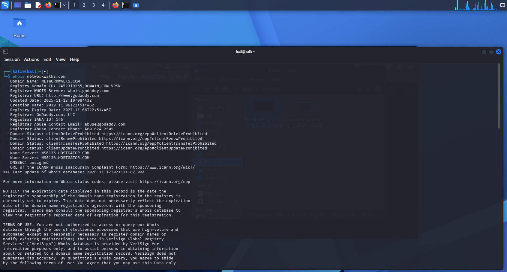

**Figure 2: whatweb**

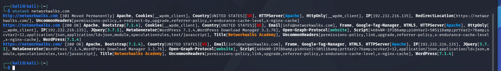

**Figure 3: nslookup**

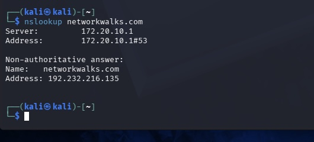

**Figure 4: curl -I**

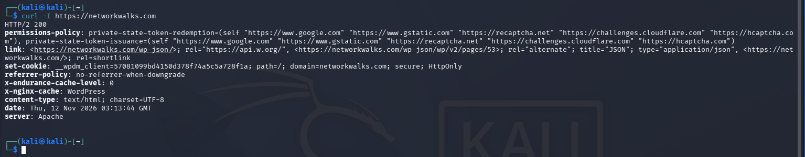

**Figure 5: wafw00f**

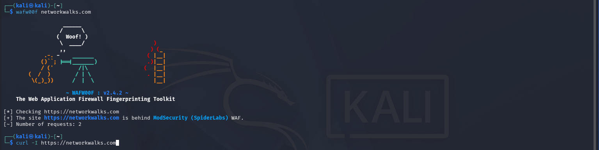

**Figure 6: dnsrecon**

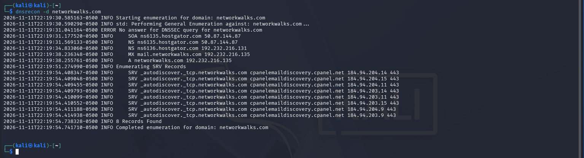

## W2-PM5: Zenmap Scanning

**Figure 7: Zenmap installed**

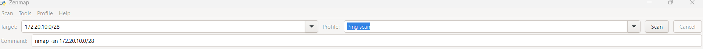

**Figure 8: Local IP and subnet**

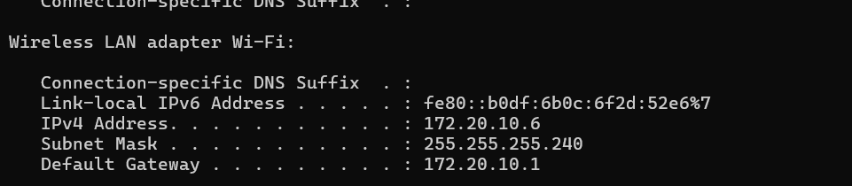

**Figure 9: Ping scan results**

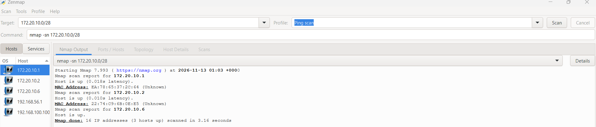

**Figure 10: Local MAC address**

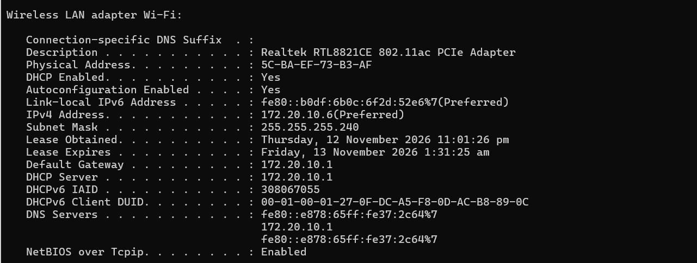

**Figure 11: Network topology**

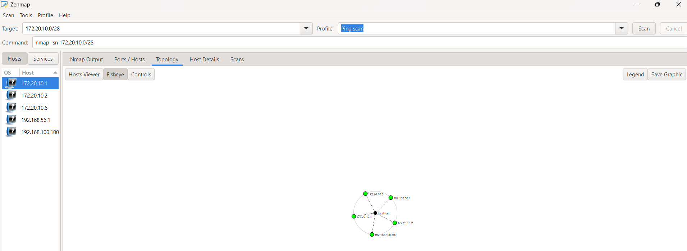

# 9. Full Report

The complete penetration testing report, including detailed explanations, findings, risk analysis, recommendations and supporting documentation, can be accessed below.

📄 **[View Full Penetration Testing Report](Report/Kwabena_Ansah-Amtwi_W2-PM1_W2-PM5_Report_B084.pdf)**)
